# RentFlow

[](https://github.com/bitwindamountains/RentFlow/actions/workflows/ci.yml)

Rent collection and property management for Philippine landlords: leases, automatic monthly billing, payments with receipts, arrears, deposits, expenses, maintenance, and a tenant portal. An installable PWA on a NestJS + PostgreSQL API.

**[Try the live demo →](https://rentflow-demo-x6iq.onrender.com)** Click **Try the demo** for your own seeded workspace. No sign-up needed. It runs on free hosting, so the first load can take about a minute while the server wakes up.

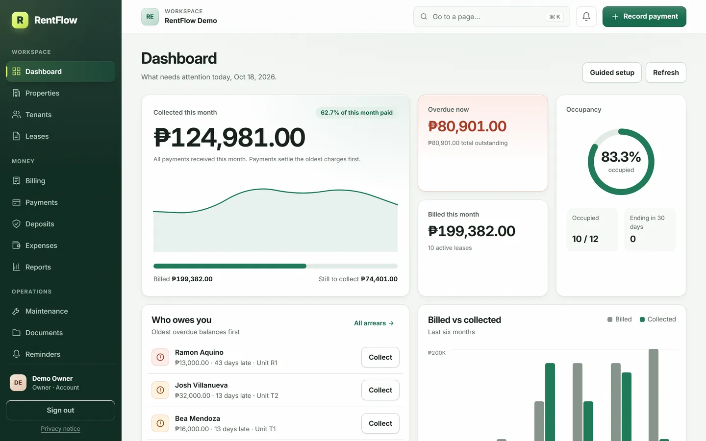


## Walkthrough: the landlord

**1. Set up a rental.** A four-step guided setup creates the property, unit, tenant, lease and first charge together, or not at all.

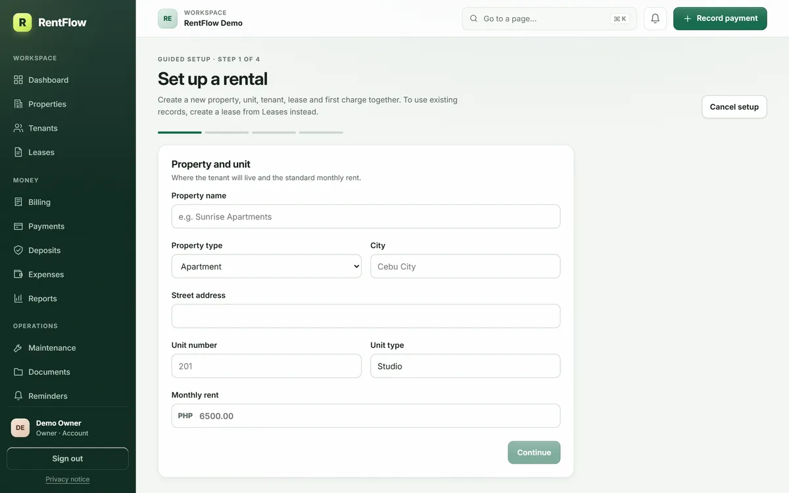

**2. See who owes what.** Rent posts itself each month. Billing groups arrears by age, and **Collect** starts a payment for any overdue tenant.

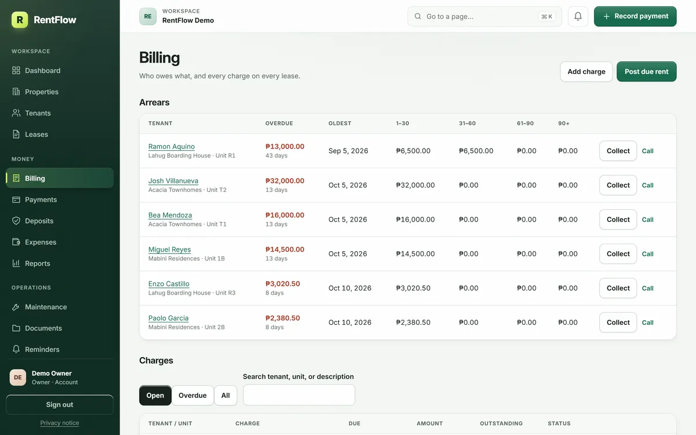

**3. Record a payment.** Cash, GCash or bank transfer, partial or back-dated. Each payment settles the oldest open charge first, and gets a numbered acknowledgement receipt.

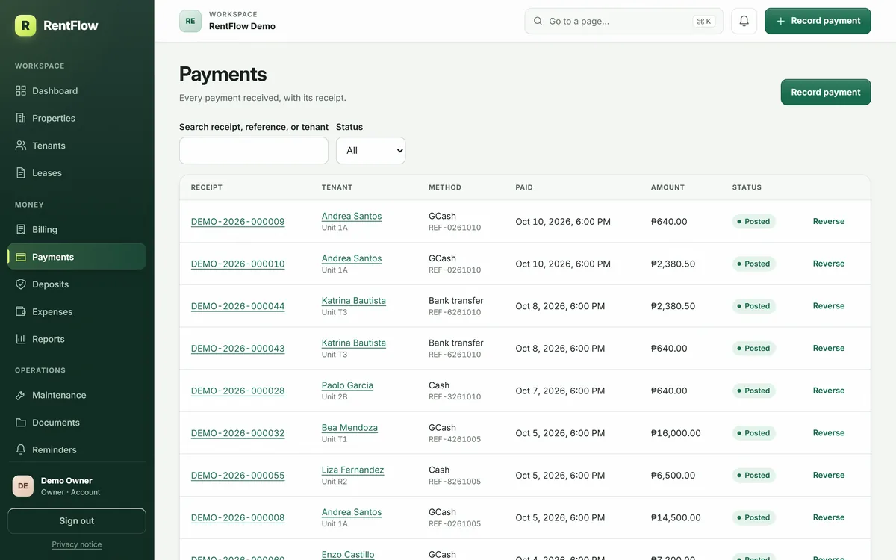

**4. Track repairs.** Work orders sorted by urgency, each tied to a unit and a vendor, from open to complete.

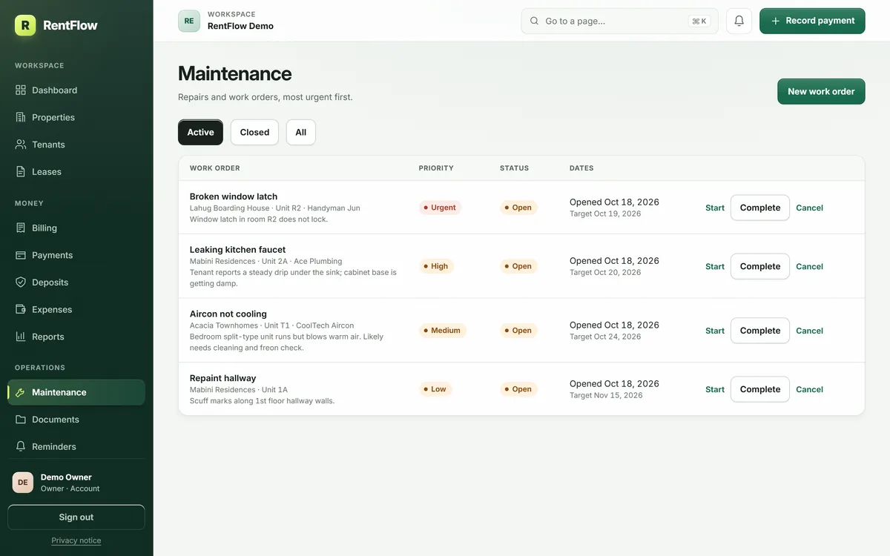

**5. Close the month.** Billed, collected, expenses and net per property for any period, with the transactions exported as CSV.

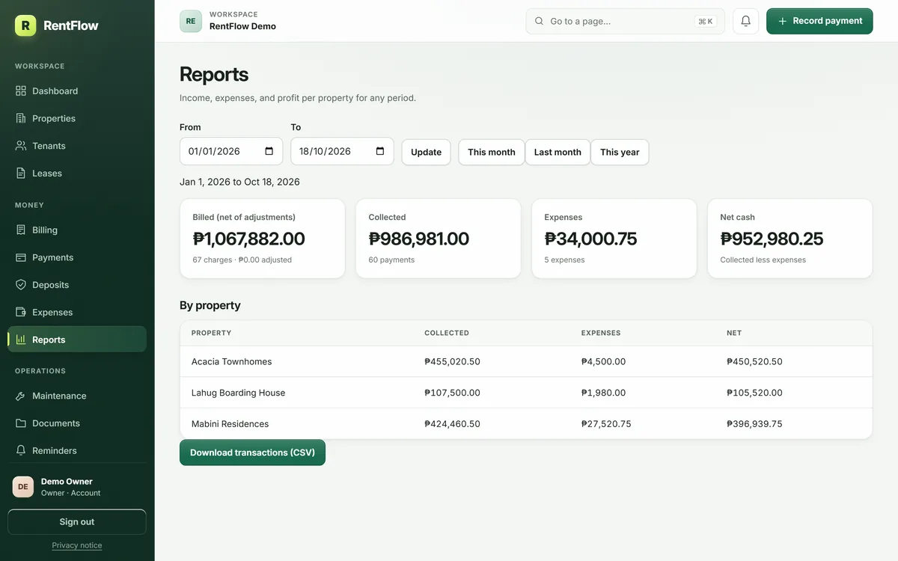

## Walkthrough: the tenant portal

<table>
  <tr>
    <td width="25%">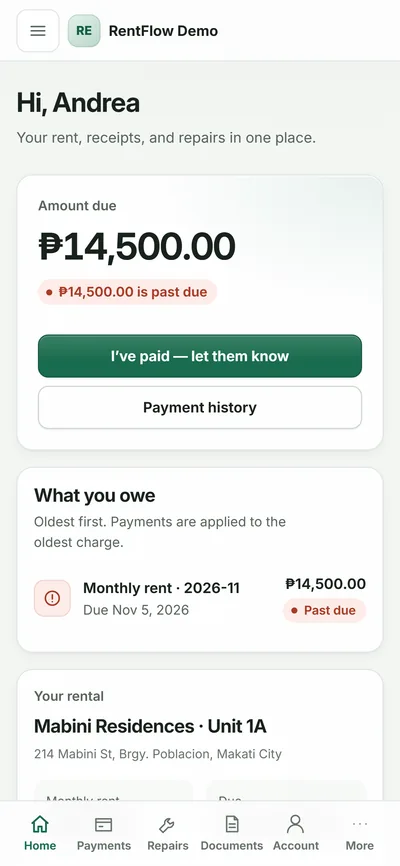</td>
    <td width="25%">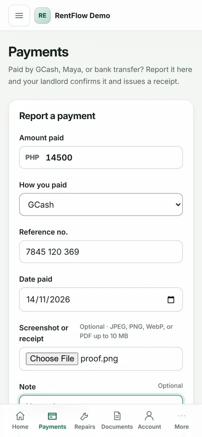</td>
    <td width="25%">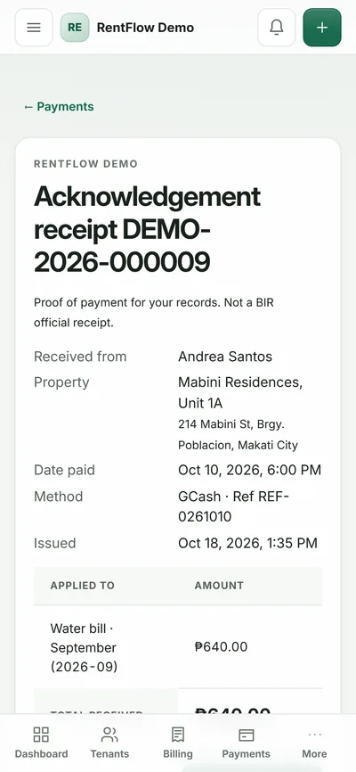</td>
    <td width="25%">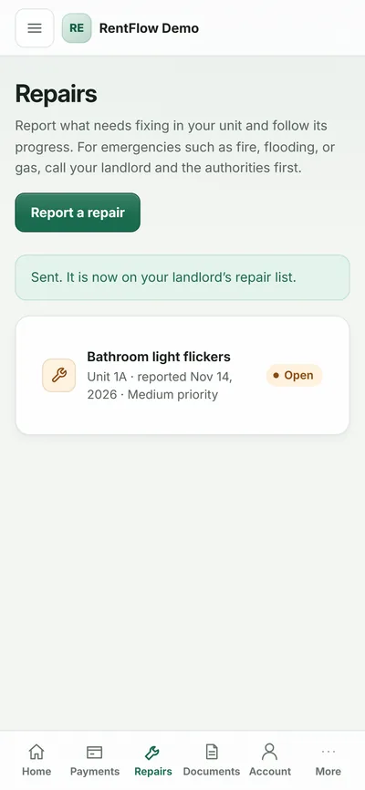</td>
  </tr>
  <tr>
    <td valign="top"><b>1. See what you owe.</b> The amount due and anything past due come first.</td>
    <td valign="top"><b>2. Report a payment.</b> GCash, Maya or bank transfer, with the reference number, the date and an optional screenshot.</td>
    <td valign="top"><b>3. Get the receipt.</b> Once staff confirm the report, the numbered receipt shows which charge it settled.</td>
    <td valign="top"><b>4. Ask for a repair.</b> Requests go straight onto the landlord's maintenance list, and the tenant can follow the status.</td>
  </tr>
</table>

Staff check each reported payment against their own GCash, Maya or bank records before confirming it:

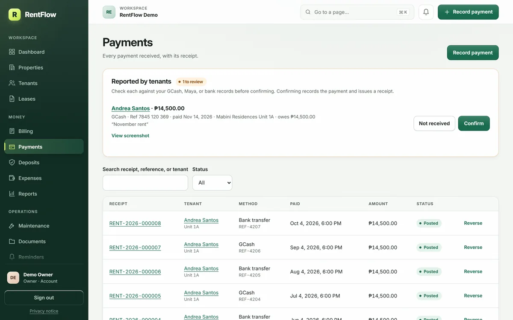

## Features

- **Guided setup:** property, unit, tenant, lease and first charge are created in one step, all or nothing
- **Automatic billing:** monthly rent is posted automatically (with catch-up), plus prorated move-ins, rent changes, renewals, move-outs and lease expiry
- **Collections:** arrears with aging buckets and grace periods, and a one-tap **Collect** button for any overdue tenant
- **Payments:** partial and back-dated payments are applied to the oldest charge first, with printable acknowledgement receipts and reversals
- **Corrections without editing history:** discounts, waivers, credit notes and voids. Posted records are never edited or deleted.
- **Money tracking:** security deposits kept separate from income, expenses with per-property profit and loss, CSV export
- **Operations:** maintenance work orders, private document uploads, reminders
- **Team roles:** owner, manager, collector, maintenance and viewer, with invites, role changes and suspension
- **Tenant portal:** tenants see what they owe and their receipts, report GCash, Maya or bank payments with a screenshot for staff to confirm, and request repairs
- **Accounts:** email verification, password reset, two-step sign-in with an authenticator app, session management, multiple workspaces

## Engineering highlights

- **Ledger-style accounting:** money is stored as `Decimal(19,4)`. A mistake is fixed with a reversal or a credit note, never by editing a posted record, so every balance can be traced.
- **Tenant isolation is tested:** an end-to-end "IDOR sweep" calls the record endpoints as a user from another workspace, using real record IDs, and expects every read and write to be refused.
- **Safe retries:** payment requests accept an `Idempotency-Key`, so a double-tap or a network retry records the payment only once. Concurrency is covered by the end-to-end tests.
- **260 automated tests** in CI: 69 API unit, 151 API end-to-end (on a real, disposable PostgreSQL) and 40 web.

## Tech stack

| Part | Technology |
| --- | --- |
| API (`apps/api`) | NestJS 12 on Fastify, Prisma 6, PostgreSQL 17, TypeScript |
| Web (`apps/web`) | Angular 22 PWA: standalone components, signals, lazy routes, service worker |
| Tests | Vitest: API unit tests, API end-to-end tests on a real PostgreSQL, web tests |
| Delivery | GitHub Actions CI, Docker Compose with Caddy, Render demo |

## Run it locally

Requires Node.js 24+ and npm 11+.

```sh
cp apps/api/.env.example apps/api/.env
npm install
docker compose up -d                      # or, on Windows without Docker: npm run db:local --workspace api
npm run db:deploy --workspace api         # apply migrations
npm run db:seed:test                      # optional: demo@rentflow.local / RentFlowDemo!2026
npm run dev:api                           # http://localhost:3000 (Swagger: /api/docs)
npm run dev:web                           # http://localhost:4200
```

In development, emails (verification, reset, invitations) are printed to the API console instead of being sent. The seed command refuses to run in production.

## Checks

```sh
npm run lint --workspace api
npm run typecheck --workspace api
npm test                                  # API unit tests + web tests
npm run test:e2e --workspace api          # API end-to-end tests on a real, disposable PostgreSQL
npm run build
npm audit --omit=dev
```

The end-to-end suite starts an embedded PostgreSQL automatically, or uses `TEST_DATABASE_URL` if it is set (as in CI). [CI](.github/workflows/ci.yml) runs all of these on every push.

## Deployment

- [docs/deployment.md](docs/deployment.md): production with Docker Compose and Caddy for HTTPS
- [docs/production-operations.md](docs/production-operations.md): how billing, security and background jobs behave in production
- [docs/deployment-render-demo.md](docs/deployment-render-demo.md): the free public demo on Render
- [docs/deployment-vercel.md](docs/deployment-vercel.md): an alternative free setup on Vercel

Planning notes and past reviews are kept in [docs/dev-notes](docs/dev-notes/).
